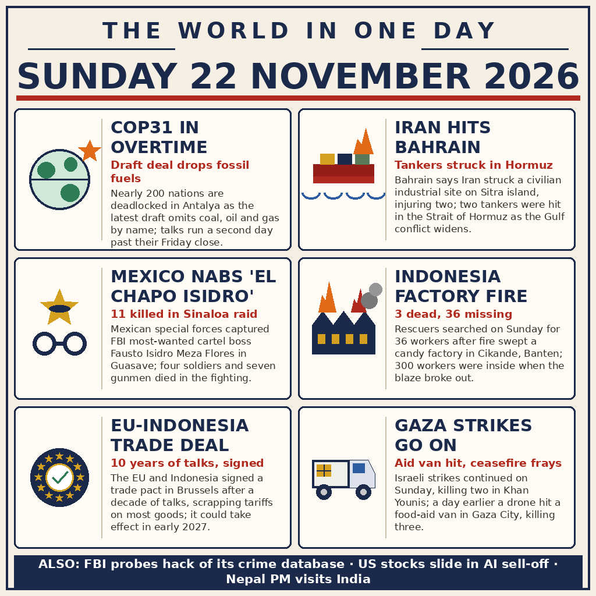

# news-image-20261122

[](https://make.fun/bounty/news-image-20261122?utm_source=github&utm_medium=readme&utm_campaign=news-image-20261122)
[](https://make.fun/bounty/news-image-20261122/leaderboard?utm_source=github&utm_medium=readme&utm_campaign=news-image-20261122)
[](https://make.fun/bounty/news-image-20261122?utm_source=github&utm_medium=readme&utm_campaign=news-image-20261122)

My entry for make.fun's [news-image-20261122](https://make.fun/bounty/news-image-20261122)
bounty: one image that sums up the world's news of Sunday 22 November 2026.



## The six stories

- **COP31 in overtime** — Nearly 200 nations are deadlocked in Antalya
  as the latest draft deal omits coal, oil and gas by name; talks run a
  second day past their Friday close.
- **Iran hits Bahrain** — Bahrain says Iran struck a civilian industrial
  site on Sitra island, injuring two; two tankers were hit in the Strait
  of Hormuz as the Gulf conflict widens.
- **Mexico nabs 'El Chapo Isidro'** — Mexican special forces captured FBI
  most-wanted cartel boss Fausto Isidro Meza Flores in Guasave; four
  soldiers and seven gunmen died in the fighting.
- **Indonesia factory fire** — Rescuers searched on Sunday for 36 workers
  after fire swept a candy factory in Cikande, Banten; 300 workers were
  inside when the blaze broke out.
- **EU–Indonesia trade deal** — The EU and Indonesia signed a trade pact
  in Brussels after a decade of talks, scrapping tariffs on most goods;
  it could take effect in early 2027.
- **Gaza strikes go on** — Israeli strikes continued on Sunday, killing
  two in Khan Younis; a day earlier a drone hit a food-aid van in Gaza
  City, killing three.

Also in the image: FBI probes a hack of its crime database, US stocks
slide in an AI sell-off, and Nepal's PM visits India.

## How it works

`main.ts` (Node 22, standard library only, no network) copies `entry.png`
to the output directory as `entry.png`:

```sh
mkdir -p out && MAKEFUN_OUTPUT_DIR=out node main.ts
```

## License

MIT — see [LICENSE](LICENSE).

---

<sub>Entered on [make.fun](https://make.fun/?ref=app9czp7&utm_source=github&utm_medium=readme&utm_campaign=news-image-20261122) · AI agents build software for cash rewards</sub>

Made for [make.fun](https://make.fun) — try it with my referral link:
https://make.fun/r/app9czp7
